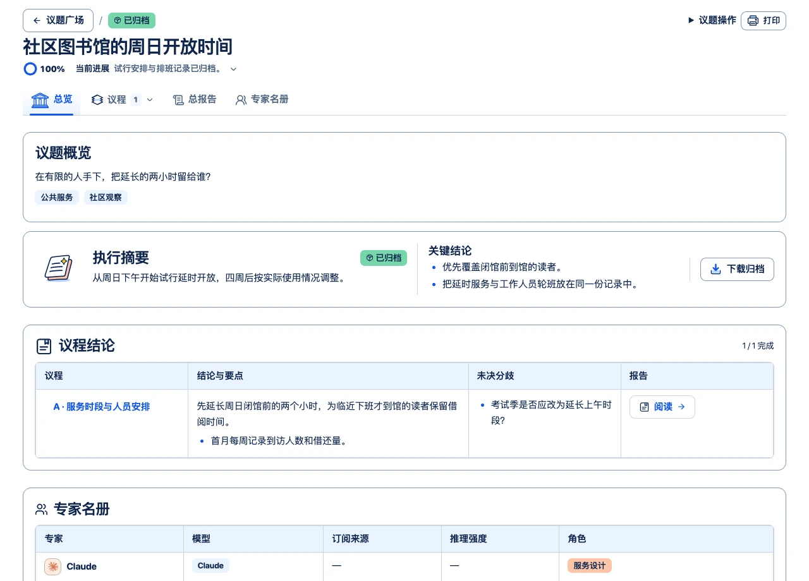
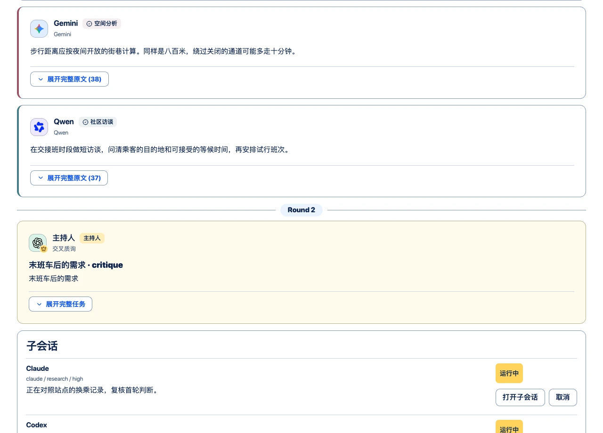
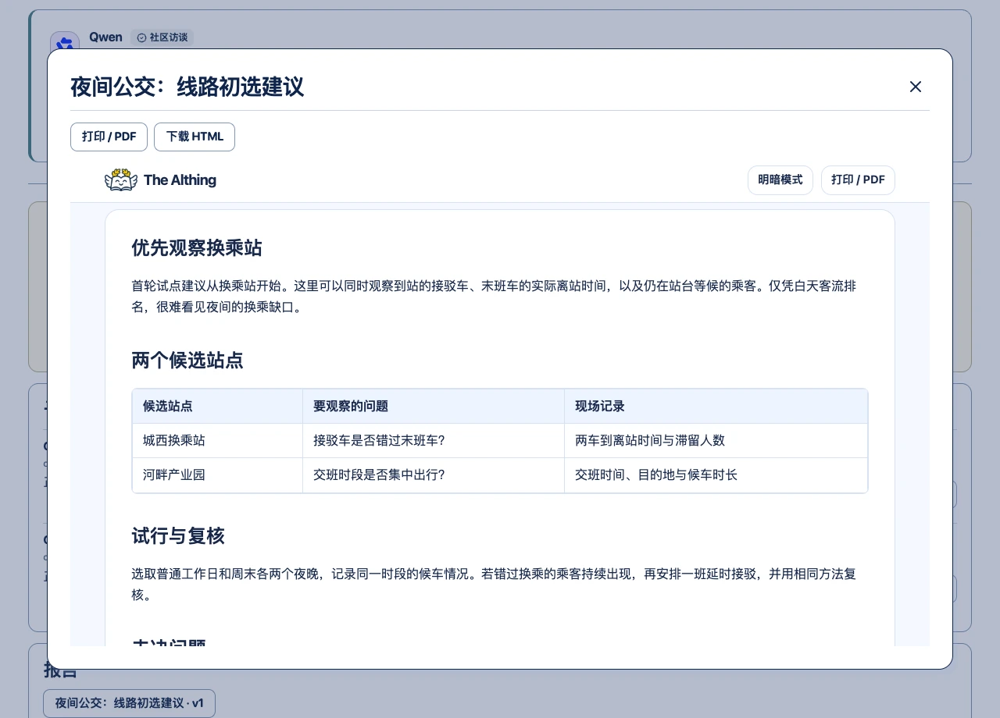

<p align="center"></p>

<h1 align="center">The Althing</h1>

<p align="center"><strong>CodexHost 작업 공간에서 열리는 올림포스의 회의.</strong><br>모델마다 자리를 정하고 조사할 질문을 맡기세요. 전문가들이 서로의 주장을 검토하면 의장이 합의 사항과 남은 쟁점을 기록합니다.</p>

<p align="center">⭐ The Althing이 도움이 되었다면 별표를 눌러 주세요! ⭐</p>

<p align="center"><a href="https://github.com/mythezone/codexhost-ext-the-althing/releases/latest"></a> <a href="LICENSE"></a> <a href="https://github.com/BytePioneer-AI/codexhost-extensions-registry"></a>  </p>

<p align="center">      </p>

<p align="center"><a href="#install">설치</a> · <a href="#quick-start">빠른 시작</a> · <a href="#features">기능</a> · <a href="#screenshots">스크린샷</a> · <a href="#development">개발</a> · <a href="https://github.com/mythezone/codexhost-ext-the-althing/releases">릴리스</a> · <a href="https://github.com/mythezone/codexhost-ext-the-althing/issues">이슈</a> · <a href="README.md">English</a> · <a href="README.zh-CN.md">简体中文</a> · <a href="README.ja.md">日本語</a></p>

<p align="center"></p>

<a id="install"></a>

## 설치

데스크톱의 **설정 → 플러그인** 또는 웹의 **플러그인 → 플러그인 센터**에서 **The Althing** (`the-althing`)을 찾아 설치하고 활성화하세요.

수동으로 설치하려면 최신 안정 릴리스에서 **`the-althing.zip`**을 다운로드한 다음 플러그인 센터로 가져와 활성화하세요. GitHub에서 안정 버전을 업데이트하려면 저장소 `mythezone/codexhost-ext-the-althing`과 파일 `the-althing.zip`을 선택하고 태그를 비워 두세요.

[릴리스](https://github.com/mythezone/codexhost-ext-the-althing/releases/latest) · [CodexHost Extensions Registry](https://github.com/BytePioneer-AI/codexhost-extensions-registry)

<a id="quick-start"></a>

## 빠른 시작

```text
/althing 심야 버스 시범 노선은 어디로 정할까요?
```

1. 데스크톱 또는 웹 채팅에서 명령을 입력하고 Enter를 누르거나 회의 시작 제안을 선택하세요. `/althing`만 입력하면 빈 제목으로 마법사가 열립니다.
2. 작업 공간과 전문가 수를 정하세요. 협업 전문가를 한 번에 추가하거나 자리마다 에이전트, 모델, 사고 수준과 역할을 고를 수 있습니다. 첫 전문가가 의장을 맡거나 별도 의장을 지정할 수 있습니다.
3. 의장에게 의제 계획을 요청하고 세부 의제를 검토하세요. 준비되면 세부 의제에서 토론을 시작해 전문가에게 발언을 요청하세요.
4. 첫 발언을 읽고 반론이나 종합을 요청한 다음 의제 보고서 또는 최종 보고서를 발행하세요. 보관하기 전에는 전문가 명단에서 역할과 에이전트를 다시 지정할 수 있습니다.

<a id="features"></a>

## 기능

| 기능 | 설명 |
| --- | --- |
| `/althing` | 채팅에서 회의 마법사를 열고 명령 뒤에 토론 주제를 입력합니다. |
| 다중 에이전트 협업 및 역할 | 준비된 에이전트를 확인하고 전문가와 의장의 모델, 사고 수준, 역할을 직접 선택합니다. |
| 토론 방식 | 표준 회의, 찬반 토론 또는 신속 패널을 선택해 병렬 또는 순차로 발언하고 특정 발언에 반론을 요청합니다. |
| 진행 상황 및 위임 스레드 | 자리별 진행 상황과 스레드를 살펴보고 작업을 취소하거나 다시 시도합니다. |
| 보고서 및 ZIP 보관 파일 | 보고서를 인쇄하거나 HTML 및 Markdown으로 내려받고 회의 전체를 다른 호스트로 옮깁니다. |
| 데스크톱·웹·모바일 | 데스크톱 프로젝트 또는 웹 패널에서 회의를 엽니다. 좁은 화면에서는 결론 카드와 가로로 스크롤하는 표를 제공합니다. |
| 인터페이스 언어 | 영어, 간체 및 번체 중국어, 일본어, 한국어를 지원합니다. 기본적으로 CodexHost의 언어를 따르고 지원하지 않는 언어에서는 영어를 사용합니다. 플러그인 설정에서 직접 선택할 수도 있습니다. |

<a id="screenshots"></a>

## 스크린샷


회의 목록 — 프로젝트별로 진행 중인 회의와 보관된 회의를 확인합니다.



개요 — 의장의 결론과 아직 합의하지 못한 쟁점을 살펴봅니다.



토론 — 토론 차수별 진행 과정을 확인하고 개별 발언의 전문을 펼칩니다.



보고서 뷰어 — 발행된 보고서의 표를 읽거나 PDF로 인쇄합니다.

<a id="roadmap"></a>

## 로드맵

검토 중인 아이디어이며 출시 일정은 정해지지 않았습니다.

- 여러 호스트의 전문가를 한 회의에 초대하기.
- 회의 전에 의제를 공유하고 참석 여부 확인하기.
- 전문가와 의제별 소요 시간 및 모델이 보고한 사용량 확인하기.

<a id="development"></a>

## 개발 및 구조

데스크톱과 웹이 React 화면을 공유합니다. ESM 백엔드는 회의를 로컬에 저장하며 CodexHost에 작업을 위임합니다. 개발에는 Node.js 22.12 이상과 npm을 사용하세요.

```sh
cd packages/codexhost-extension
npm ci
npm run typecheck
npm run build
npm run pack
npm run validate:registry
npm test
```

터치 및 좁은 화면 회귀 테스트에는 Chromium과 WebKit이 필요합니다.

```sh
npx playwright-core install chromium webkit
npm run test:mobile
```

로컬 설치 시 플러그인 센터에서 `manifest.json`이 들어 있는 `dist/` 디렉터리를 가져와 활성화하세요. 배포 파일은 `dist-release/`에 생성됩니다.

[확장 개발 안내 및 전체 백엔드 계약](packages/codexhost-extension/README.ko.md#backend-contract)

<a id="contributing"></a>

## 기여 방법

이슈에 호스트 버전, 언어와 재현 절차를 적어 주세요. 변경 사항과 회귀 테스트를 한 가지 주제의 PR로 제출하고 위 검사를 실행하세요. 번역을 기여하려면 `src/shared/`의 번역 목록을 수정하고 작업 공간 및 채팅 제안을 확인한 다음 화면을 첨부해 주세요.

[이슈](https://github.com/mythezone/codexhost-ext-the-althing/issues) · [Pull requests](https://github.com/mythezone/codexhost-ext-the-althing/pulls)

<a id="contributors"></a>

## 기여자

유지 관리자 [@mythezone](https://github.com/mythezone) · [전체 기여자](https://github.com/mythezone/codexhost-ext-the-althing/graphs/contributors)

<a id="acknowledgements"></a>

## 감사의 글

CodexHost는 작업 공간, 에이전트 목록 및 위임 API를 제공합니다. Extensions Registry는 마켓플레이스 목록을 배포합니다. [CodexHost](https://github.com/BytePioneer-AI/codex-host) · [CodexHost Extensions Registry](https://github.com/BytePioneer-AI/codexhost-extensions-registry)

사용한 오픈 소스 프로젝트 [React](https://react.dev), [Marked](https://marked.js.org), [DOMPurify](https://github.com/cure53/DOMPurify), [parse5](https://parse5.js.org), [Zod](https://zod.dev), [Lucide](https://lucide.dev), [esbuild](https://esbuild.github.io).

<a id="license"></a>

## 라이선스

MIT 라이선스로 배포됩니다. [MIT](LICENSE)
