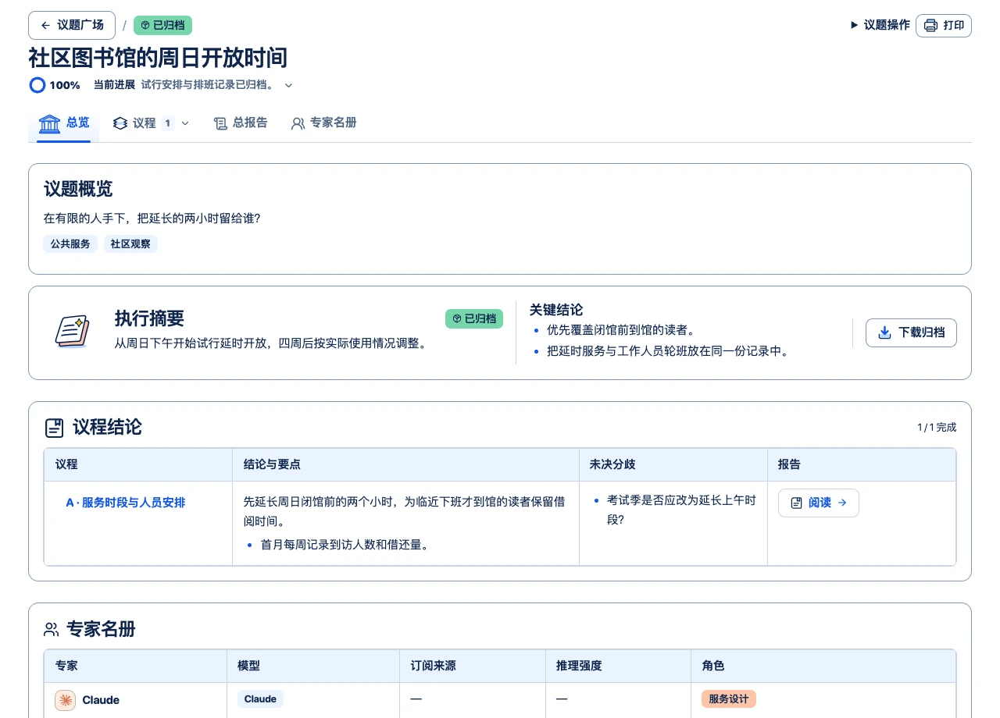
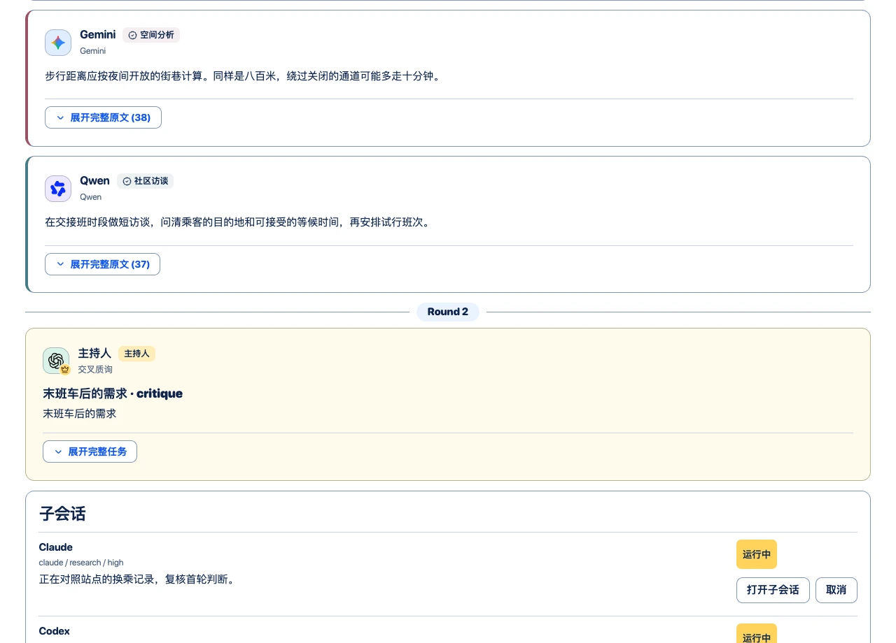
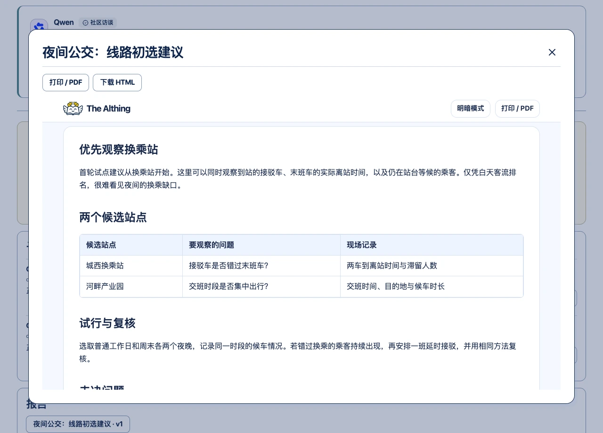

<p align="center"></p>

<h1 align="center">The Althing</h1>

<p align="center"><strong>A council on Olympus, convened in your CodexHost workspace.</strong><br>Give each model a seat and a question to investigate. Let the experts challenge one another, then ask the chair to record what they agree on and what remains open.</p>

<p align="center">⭐ If The Althing is useful to you, please give it a star! ⭐</p>

<p align="center"><a href="https://github.com/mythezone/codexhost-ext-the-althing/releases/latest"></a> <a href="LICENSE"></a> <a href="https://github.com/BytePioneer-AI/codexhost-extensions-registry"></a>  </p>

<p align="center">      </p>

<p align="center"><a href="#install">Install</a> · <a href="#quick-start">Quick Start</a> · <a href="#features">Features</a> · <a href="#screenshots">Screenshots</a> · <a href="#development">Development</a> · <a href="https://github.com/mythezone/codexhost-ext-the-althing/releases">Releases</a> · <a href="https://github.com/mythezone/codexhost-ext-the-althing/issues">Issues</a> · <a href="README.zh-CN.md">简体中文</a> · <a href="README.ja.md">日本語</a> · <a href="README.ko.md">한국어</a></p>

<p align="center"></p>

<a id="install"></a>

## Installation

Open **Settings → Plugins** on Desktop or **Plugins → Plugin Center** on Web. Find **The Althing** (`the-althing`) in the marketplace, install it and enable it.

For a manual install, download **`the-althing.zip`** from the latest stable release, import the ZIP in the plugin center and enable it. To follow stable updates from GitHub, select `mythezone/codexhost-ext-the-althing`, choose the asset `the-althing.zip` and leave the tag empty.

[Releases](https://github.com/mythezone/codexhost-ext-the-althing/releases/latest) · [CodexHost Extensions Registry](https://github.com/BytePioneer-AI/codexhost-extensions-registry)

<a id="quick-start"></a>

## Quick Start

```text
/althing Which transit corridor should we pilot after the last bus?
```

1. Enter `/althing <topic>` (single-line or multi-line) in Desktop or Web chat and press **Enter** or click **Send** — just like `/goal`, it dispatches straight to The Althing with zero modal forms. (Press `Tab` on `/alt` to autocomplete.)
2. The Althing automatically detects your active project workspace, selects an optimal panel size and diverse ready CodexHost agents (using your Host collaboration defaults), assigns complementary topic-aware roles, and asks the chair to plan agendas and refine roles.
3. Once planning finishes, the opening round starts automatically. Watch live progress on the Kickoff Card, click **Pause auto-dispatch** if you want to edit agendas first, or click **Configure roles & agents** anytime to tweak seats.
4. For manual control up front, run bare `/althing`, `/althing --custom <topic>`, or click **+ New Council** to open the 1-screen Quick Convene modal (or use optional flags `--debate`, `--rapid`, `--experts 4`).

<a id="features"></a>

## Features

| Feature | What you can do |
| --- | --- |
| Direct `/althing` command | Send `/althing <topic>` (single- or multi-line) straight from chat like `/goal` to convene immediately — no 3-step wizard required. Supports `Tab` completion and optional `--debate`, `--rapid`, `--experts N`, `--custom` flags. |
| Smart seat, role & count allocation | Automatically chooses optimal panel size, diverse ready Host agents, defaults, and domain-tailored roles (further refined by the chair during planning), plus full manual control anytime. |
| Auto-kickoff & live progress | Plans agendas and automatically dispatches Round 1 (toggleable in plugin settings or per-council Kickoff Card), tracks delegated threads, and lets you cancel or retry any run. |
| Discussion protocols | Run a standard council, adversarial debate or rapid panel. Dispatch in parallel or in sequence and target a particular contribution for rebuttal. |
| Reports & portable ZIP archives | Read and print reports, download HTML or Markdown, and move the whole council to another host in a ZIP. |
| Desktop, Web & Mobile | Find councils under their Desktop projects, use the Hub inline Quick Convene bar, or open the Web panel. Narrow screens show conclusion cards and horizontally scrollable tables. |
| Interface languages | English, Simplified Chinese, Traditional Chinese, Japanese and Korean. The default follows CodexHost and falls back to English. Override it under **Interface language** in plugin settings. |

<a id="screenshots"></a>

## Screenshots


Council hub — filter active and archived meetings by project.



Overview — read the chair’s conclusions and unresolved questions.



Discussion — follow each round and expand individual contributions.



Report reader — review a publication, inspect a table or print to PDF.

<a id="roadmap"></a>

## Roadmap

Ideas under consideration, without a release schedule.

- Invite experts running on different hosts into the same council.
- Send an agenda in advance and let participants confirm their seats.
- Review time and model-reported usage by expert and agenda.

<a id="development"></a>

## Development & Architecture

The React workspace runs in Desktop and Web. An ESM backend stores councils locally and delegates work through CodexHost. Develop with Node.js 22.12+ and npm.

```sh
cd packages/codexhost-extension
npm ci
npm run typecheck
npm run build
npm run pack
npm run validate:registry
npm test
```

Install Chromium and WebKit once for the touch and narrow-screen regressions.

```sh
npx playwright-core install chromium webkit
npm run test:mobile
```

For local installation, import the built `dist/` directory (the one containing `manifest.json`) in the plugin center and enable it. Release files are written to `dist-release/`.

[Extension development guide and full backend contracts](packages/codexhost-extension/README.md#backend-contract)

<a id="contributing"></a>

## Contributing

Open an issue with the host version, language and steps to reproduce. For a change, open a focused pull request, add the relevant tests and run the checks above. For translations, update the shared catalog in `src/shared/`, check the language in both the workspace and the composer hint, and include a screenshot of changed controls.

[Issues](https://github.com/mythezone/codexhost-ext-the-althing/issues) · [Pull requests](https://github.com/mythezone/codexhost-ext-the-althing/pulls)

<a id="contributors"></a>

## Contributors

Maintained by [@mythezone](https://github.com/mythezone) · [All contributors](https://github.com/mythezone/codexhost-ext-the-althing/graphs/contributors)

<a id="acknowledgements"></a>

## Acknowledgements

CodexHost provides the workspaces, agent catalog and delegation API. The Extensions Registry distributes the marketplace catalog. [CodexHost](https://github.com/BytePioneer-AI/codex-host) · [CodexHost Extensions Registry](https://github.com/BytePioneer-AI/codexhost-extensions-registry)

Built with [React](https://react.dev), [Marked](https://marked.js.org), [DOMPurify](https://github.com/cure53/DOMPurify), [parse5](https://parse5.js.org), [Zod](https://zod.dev), [Lucide](https://lucide.dev), [esbuild](https://esbuild.github.io).

<a id="license"></a>

## License

Distributed under the MIT License. [MIT](LICENSE)
