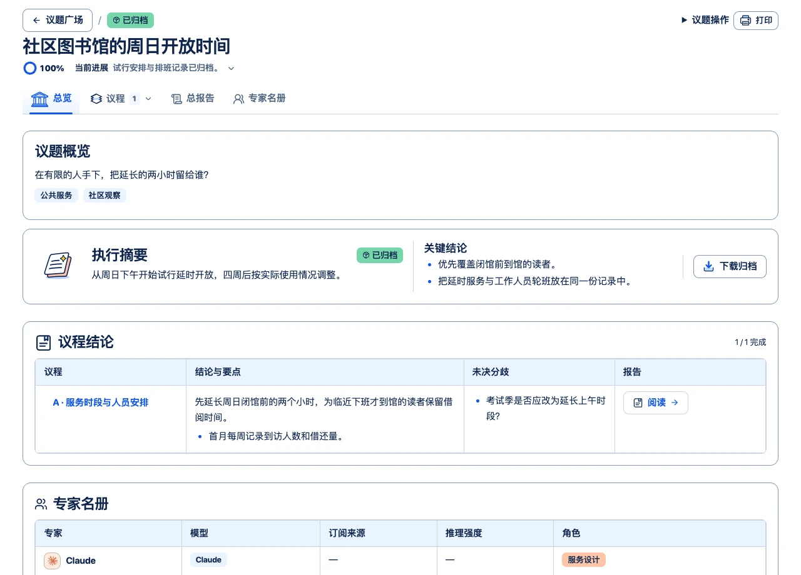
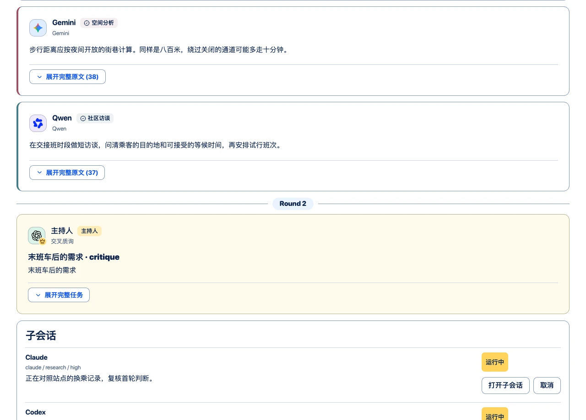
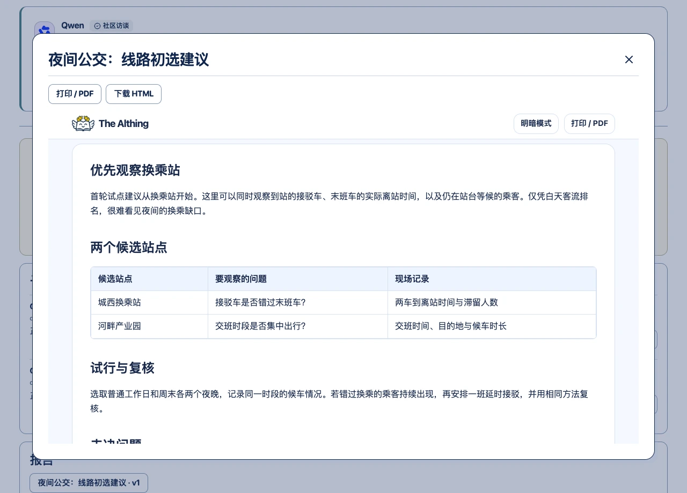

<p align="center"></p>

<h1 align="center">The Althing</h1>

<p align="center"><strong>在 CodexHost 工作区，召集一场奥林匹斯诸神议会。</strong><br>让不同模型像各有所长的诸神一样各据一席，围绕同一问题独立调查、相互质询。最后由主持人把共识、依据和尚存的分歧写进报告。</p>

<p align="center">⭐ 如果议事厅对你有帮助，欢迎为项目点一颗星！ ⭐</p>

<p align="center"><a href="https://github.com/mythezone/codexhost-ext-the-althing/releases/latest"></a> <a href="LICENSE"></a> <a href="https://github.com/BytePioneer-AI/codexhost-extensions-registry"></a>  </p>

<p align="center">      </p>

<p align="center"><a href="#install">安装</a> · <a href="#quick-start">快速开始</a> · <a href="#features">功能</a> · <a href="#screenshots">截图</a> · <a href="#development">开发</a> · <a href="https://github.com/mythezone/codexhost-ext-the-althing/releases">版本发布</a> · <a href="https://github.com/mythezone/codexhost-ext-the-althing/issues">问题反馈</a> · <a href="README.md">English</a> · <a href="README.ja.md">日本語</a> · <a href="README.ko.md">한국어</a></p>

<p align="center"></p>

<a id="install"></a>

## 安装

Desktop 打开**设置 → 插件**，Web 打开**插件 → 插件中心**。在市场中找到**议事厅 / The Althing**（`the-althing`），安装并启用。

手动安装时，从最新稳定版本下载 **`the-althing.zip`**，在插件中心导入 ZIP 并启用。若选择从 GitHub 跟踪稳定更新，仓库填 `mythezone/codexhost-ext-the-althing`，附件选 `the-althing.zip`，标签留空。

[版本发布](https://github.com/mythezone/codexhost-ext-the-althing/releases/latest) · [CodexHost Extensions Registry](https://github.com/BytePioneer-AI/codexhost-extensions-registry)

<a id="quick-start"></a>

## 快速开始

```text
/althing 末班车之后，哪条公交线路值得延时试点？
```

1. 在 Desktop 或 Web 聊天框输入上述命令，按回车或点**发起会议**。单独输入 `/althing` 可以在向导里填写主题。
2. 选工作区和专家人数。点**一键加入协作专家**可沿用 CodexHost 中已就绪的 Agent 和默认配置。每个席位都能手选 Agent、模型、推理强度和会议角色。默认由第一位专家兼任主持，也可另选主持模型。
3. 选择**创建并规划议程**，让主持人提出子议程。审阅后打开一项子议程，点**派发讨论**邀请专家发言。
4. 阅读开场陈述，按需发起质询，再选**主持人综述**，发布议程报告或总报告。在未归档议题的**专家名册 → 配置专家与角色**里，可以调整后续轮次的分工。

<a id="features"></a>

## 功能

| 功能 | 用途 |
| --- | --- |
| `/althing` | 从聊天框发起会议，可在命令后直接附上主题。 |
| 多 Agent 协作与角色分配 | 列出宿主已就绪的 Agent 和默认值，分别为专家与主持人选择模型、推理强度和角色。 |
| 讨论协议 | 选择标准议事、对抗辩论或快速专家组；可并行或按顺序派发，针对指定发言发起反驳。 |
| 任务进度与子会话 | 查看各席位进度、打开委派的子会话、取消正在执行的任务或重试失败任务。 |
| 报告与 ZIP 归档 | 阅读、打印报告，下载 HTML 或 Markdown，用 ZIP 把整场会议迁移至另一台宿主。 |
| 桌面、网页和移动端 | 从桌面项目侧栏或网页面板进入。窄屏将议程结论排列为卡片，宽表支持手势横向滚动。 |
| 界面语言 | 支持英文、简体中文、繁体中文、日语和韩语。默认跟随 CodexHost，未识别语言时使用英文。也可在插件设置的**界面语言**中手动指定。 |

<a id="screenshots"></a>

## 界面截图


议题广场：按项目查看进行中与已归档的会议。



议题总览：查看主持人的结论、要点与未决分歧。



子议程讨论：按轮次阅读专家回应，并按需展开发言全文。



报告阅读器：查看正文和表格，或打印为 PDF。

<a id="roadmap"></a>

## 路线图

以下为待探索方向，尚未排期。

- 邀请不同宿主上的专家加入同一场会议。
- 提前发出议程，由受邀者确认参与席位。
- 按议程和专家回顾讨论耗时及模型提供的用量记录。

<a id="development"></a>

## 开发与架构

Desktop 和 Web 共用 React 工作区。ESM 后端在本地保存议题，通过 CodexHost 委派任务。开发环境使用 Node.js 22.12+ 和 npm。

```sh
cd packages/codexhost-extension
npm ci
npm run typecheck
npm run build
npm run pack
npm run validate:registry
npm test
```

首次运行触控和窄屏回归前安装 Chromium 和 WebKit。

```sh
npx playwright-core install chromium webkit
npm run test:mobile
```

本机安装时，在插件中心导入含 `manifest.json` 的构建目录 `dist/` 并启用。发布附件位于 `dist-release/`。

[扩展开发指南与完整后端契约](packages/codexhost-extension/README.zh-CN.md#backend-contract)

<a id="contributing"></a>

## 参与贡献

反馈问题时请注明宿主版本、界面语言和复现步骤。提交改动时请发起范围明确的 PR，补充对应测试并运行上述校验。添加翻译时请更新 `src/shared/` 的共享词表，在工作区和聊天命令提示中核对效果，并附上改动控件的截图。

[问题反馈](https://github.com/mythezone/codexhost-ext-the-althing/issues) · [Pull requests](https://github.com/mythezone/codexhost-ext-the-althing/pulls)

<a id="contributors"></a>

## 贡献者

维护者 [@mythezone](https://github.com/mythezone) · [查看全部贡献者](https://github.com/mythezone/codexhost-ext-the-althing/graphs/contributors)

<a id="acknowledgements"></a>

## 致谢

感谢 CodexHost 提供项目工作区、Agent 目录和委派接口，感谢扩展注册表维护插件市场目录。 [CodexHost](https://github.com/BytePioneer-AI/codex-host) · [CodexHost Extensions Registry](https://github.com/BytePioneer-AI/codexhost-extensions-registry)

使用的开源依赖 [React](https://react.dev), [Marked](https://marked.js.org), [DOMPurify](https://github.com/cure53/DOMPurify), [parse5](https://parse5.js.org), [Zod](https://zod.dev), [Lucide](https://lucide.dev), [esbuild](https://esbuild.github.io).

<a id="license"></a>

## 许可证

本项目使用 MIT 许可证。 [MIT](LICENSE)
