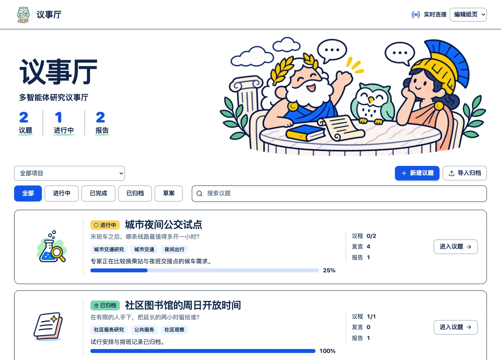
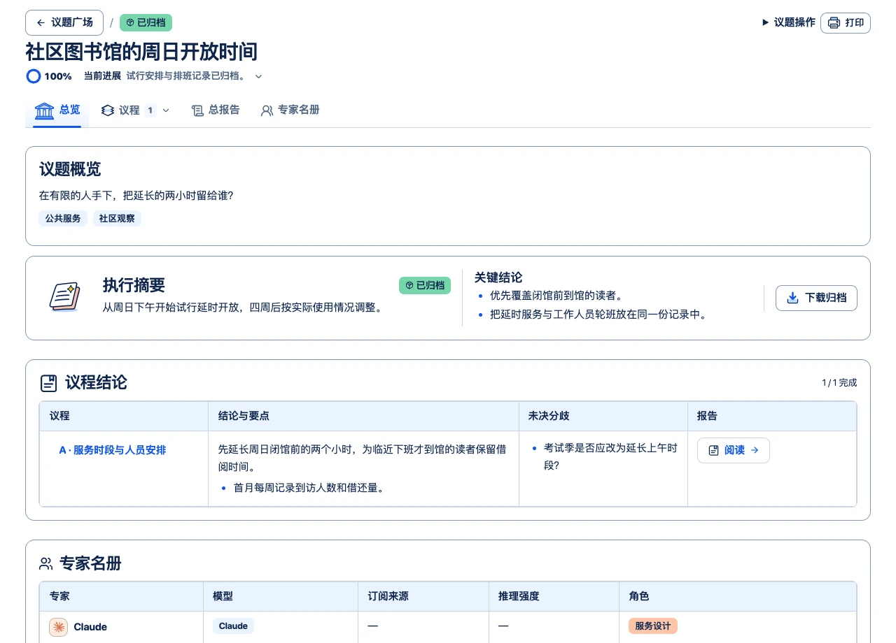
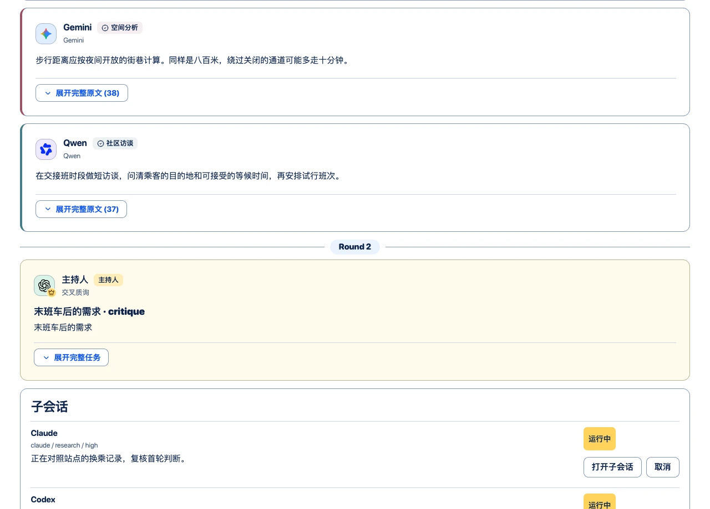
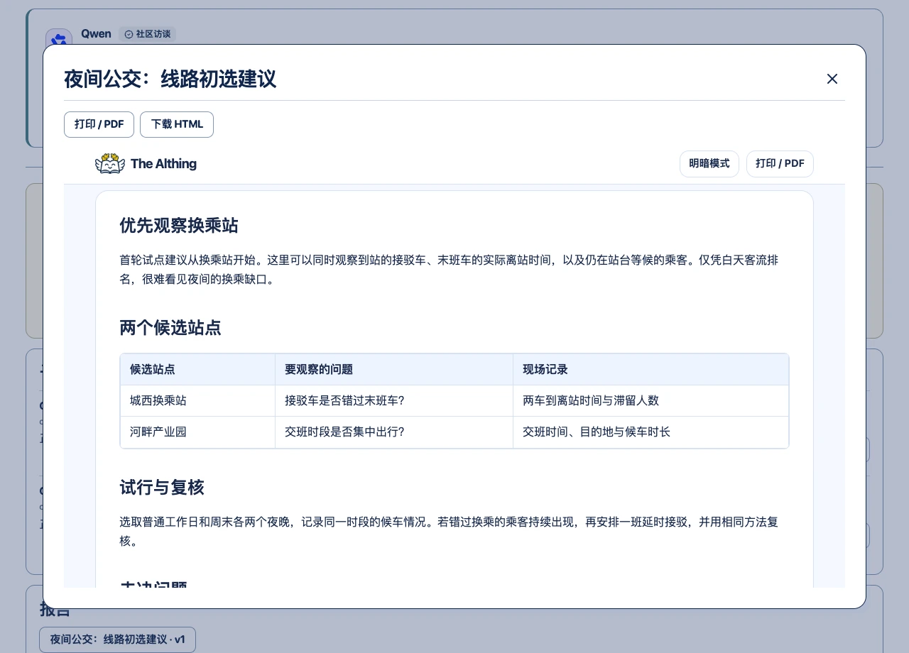

<p align="center"></p>

<h1 align="center">The Althing</h1>

<p align="center"><strong>CodexHost のワークスペースに、オリュンポスの評議会を。</strong><br>得意分野の異なるモデルに席を用意し、一つの問いをそれぞれの視点から検討してもらいます。互いの論拠を問い直したあと、司会者が合意点と残された争点をレポートにまとめます。</p>

<p align="center">⭐ The Althing が役に立ったら、ぜひスターをお願いします！ ⭐</p>

<p align="center"><a href="https://github.com/mythezone/codexhost-ext-the-althing/releases/latest"></a> <a href="../../LICENSE"></a> <a href="https://github.com/BytePioneer-AI/codexhost-extensions-registry"></a>  </p>

<p align="center">      </p>

<p align="center"><a href="#install">インストール</a> · <a href="#quick-start">使い方</a> · <a href="#features">機能</a> · <a href="#screenshots">画面例</a> · <a href="#development">開発</a> · <a href="https://github.com/mythezone/codexhost-ext-the-althing/releases">リリース</a> · <a href="https://github.com/mythezone/codexhost-ext-the-althing/issues">Issues</a> · <a href="README.md">English</a> · <a href="README.zh-CN.md">简体中文</a> · <a href="README.ko.md">한국어</a></p>

<p align="center"></p>

<a id="install"></a>

## インストール

Desktop では **設定 → プラグイン**、Web では **プラグイン → プラグインセンター** を開きます。マーケットプレイスで **The Althing**（`the-althing`）を選び、インストールして有効にしてください。

手動で導入する場合は、最新の安定版から **`the-althing.zip`** をダウンロードし、プラグインセンターで ZIP をインポートして有効にします。GitHub から安定版を追跡する場合は、リポジトリを `mythezone/codexhost-ext-the-althing`、アセットを `the-althing.zip` に設定し、タグは空欄にします。

[リリース](https://github.com/mythezone/codexhost-ext-the-althing/releases/latest) · [CodexHost Extensions Registry](https://github.com/BytePioneer-AI/codexhost-extensions-registry)

<a id="quick-start"></a>

## クイックスタート

```text
/althing 終バス後の延長運行は、どの路線で試すべきか？
```

1. Desktop または Web のチャットに上のコマンドを入力して Enter を押すか、**会議を開く**を選びます。`/althing` だけ入力して、後から議題を決めることもできます。
2. ワークスペースと専門家の人数を選びます。**連携設定済みの専門家を追加**すると、ホスト側の既定のモデルと推論レベルを利用できます。各席のエージェント、モデル、推論レベル、役割は個別に変更できます。最初の専門家が司会を兼ねますが、別のモデルの指定も可能です。
3. **会議を作成して議案を計画**を選ぶと、司会モデルが小議案を提案します。内容を確認し、小議案を開いて**討議を依頼**します。
4. 各専門家の冒頭陳述を読み、必要に応じて質疑を依頼し、**司会者の総括**を選びます。議案ごとのレポートや最終レポートを公開できます。アーカイブ前なら**専門家名簿 → 専門家と役割を設定**で次回以降の担当を変更できます。

<a id="features"></a>

## 機能

| 機能 | できること |
| --- | --- |
| `/althing` | チャットから会議を開きます。コマンドの後に議題名も指定できます。 |
| エージェント連携と役割分担 | 利用可能なエージェントを確認し、専門家・司会者のモデル、推論レベル、役割を指定します。 |
| 討議プロトコル | 標準評議会、対抗討論、クイックパネルに対応。並列・順次で発言を依頼でき、反論の対象も指定できます。 |
| 進捗と委派先スレッド | 各席の進捗を確認し、スレッドを開きます。実行中の依頼はキャンセルでき、失敗時は再試行できます。 |
| レポートと ZIP アーカイブ | レポートの閲覧・印刷、HTML・Markdown のダウンロード、会議全体の ZIP による移行に対応します。 |
| Desktop・Web・モバイル | デスクトップのプロジェクト欄や Web パネルから開けます。狭い画面では結論をカードで表示し、横長の表はスワイプできます。 |
| 表示言語 | 英語、簡体字中国語、繁体字中国語、日本語、韓国語に対応。既定では CodexHost の言語に従い、未対応の場合は英語を使います。プラグイン設定の **Interface language** でも変更できます。 |

<a id="screenshots"></a>

## スクリーンショット



議題一覧。プロジェクトごとに進行中・アーカイブ済みの会議を絞り込みます。



概要。司会者の結論と未解決の争点を確認します。



討議。ラウンドごとに発言をたどり、全文を表示できます。



レポートリーダー。本文と表を読み、PDF に印刷できます。

<a id="roadmap"></a>

## ロードマップ

以下は検討中の案です。リリース時期は未定です。

- 別々のホストで動く専門家を同じ会議に招く。
- 事前に議案を送り、招待された参加者が出席を確定する。
- 専門家別・議案別に所要時間とモデルの利用量を振り返る。

<a id="development"></a>

## 開発とアーキテクチャ

Desktop と Web は React ワークスペースを共有します。ESM バックエンドが会議をローカルに保存し、CodexHost を通じて作業を委派します。開発には Node.js 22.12 以降と npm を使用します。

```sh
npm ci
npm run typecheck
npm run build
npm run pack
npm run validate:registry
npm test
```

タッチ操作・狭い画面の回帰テストには、初回に Chromium と WebKit をインストールしてください。

```sh
npx playwright-core install chromium webkit
npm run test:mobile
```

ローカルで試すには、ビルド結果の `dist/`（`manifest.json` があるディレクトリ）をプラグインセンターでインポートして有効にします。配布物は `dist-release/` に生成されます。

<a id="backend-contract"></a>

### バックエンド仕様

RPC の接頭辞は `althing/` です。リソースのフィールド名は snake_case、呼び出しパラメーターには `topicId` などを使います。付属クライアントが非同期操作の照会と分割転送を処理します。

| RPC グループ | 仕様 |
| --- | --- |
| `capabilities, codexhost/*` | ホストのワークスペースと利用可能なメソッドを取得します。`agents({ cwd?, refresh? })` は準備状態、連携の既定値、モデル別の推論レベルを返します。 |
| `topics/*` | 議題の作成・一覧・取得・更新・削除。`get({ topicId, summaryOnly: true })` は長文を省略し、`body({ topicId, kind, resourceId })` で発言・依頼の本文を取得します。 |
| `agendas/*, sub-agendas/*, dispatches/*, contributions/*` | 議案、小議案、依頼、発言を作成します。発言の要約やタグは更新できますが、公開済みの原文は保持されます。 |
| `council/*` | 議案の計画、討議の依頼、総括、議案の結論、レポートの生成を行います。実行一覧を取得し、`runId` でキャンセル・再試行できます。 |
| `reports/*` | レポートを公開し、`topicId` と `reportId` で本文を取得します。レポートとオフラインビューアーの表示言語を指定できます。 |
| `archives/*, exports/*` | アーカイブの作成と一覧。`import-begin`、`import-chunk`、`import-commit` で分割インポートします。ZIP、単体 HTML、Markdown バンドルは 512 KiB ごとに取得します。 |
| `operations/get, events/since, transfers/release` | `operationId` で完了を照会します。大きな JSON は base64 チャンクを結合して UTF-8 として読み、転送を解放します。イベントはカーソルで再取得し、履歴が欠けた場合は再読込します。 |

<a id="contributing"></a>

## 貢献するには

不具合を報告する際はホストのバージョン、表示言語、再現手順を添えてください。変更内容を絞ったプルリクエストに関連テストを追加し、上記の検証を実行してください。翻訳を追加する場合は `src/shared/` の辞書を更新し、ワークスペースとチャットのコマンド候補で表示を確認し、変更した画面を添付してください。

[Issues](https://github.com/mythezone/codexhost-ext-the-althing/issues) · [Pull requests](https://github.com/mythezone/codexhost-ext-the-althing/pulls)

<a id="contributors"></a>

## コントリビューター

メンテナー [@mythezone](https://github.com/mythezone) · [すべてのコントリビューター](https://github.com/mythezone/codexhost-ext-the-althing/graphs/contributors)

<a id="acknowledgements"></a>

## 謝辞

CodexHost のワークスペース、エージェントカタログ、委派 API、およびマーケットプレイスを運営する Extensions Registry に感謝します。 [CodexHost](https://github.com/BytePioneer-AI/codex-host) · [CodexHost Extensions Registry](https://github.com/BytePioneer-AI/codexhost-extensions-registry)

利用しているオープンソース [React](https://react.dev), [Marked](https://marked.js.org), [DOMPurify](https://github.com/cure53/DOMPurify), [parse5](https://parse5.js.org), [Zod](https://zod.dev), [Lucide](https://lucide.dev), [esbuild](https://esbuild.github.io).

<a id="license"></a>

## ライセンス

MIT ライセンスで配布しています。 [MIT](../../LICENSE)
