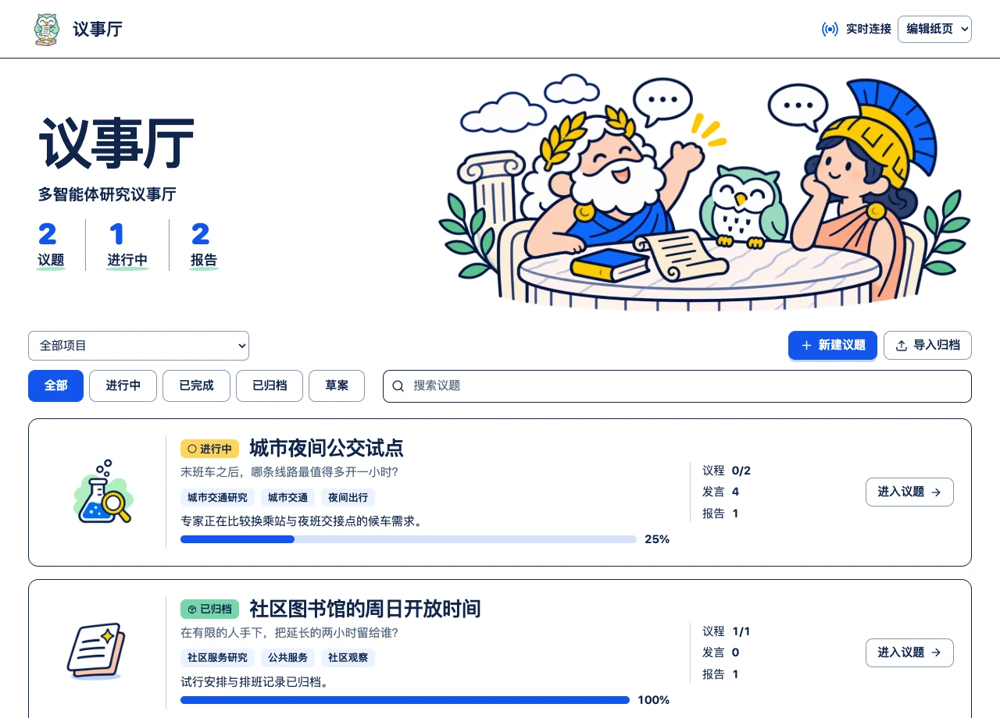
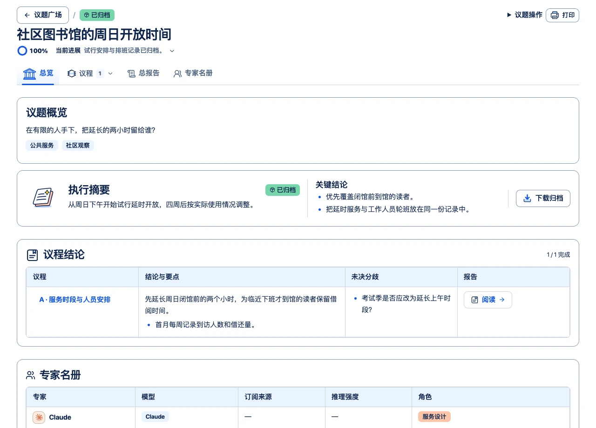
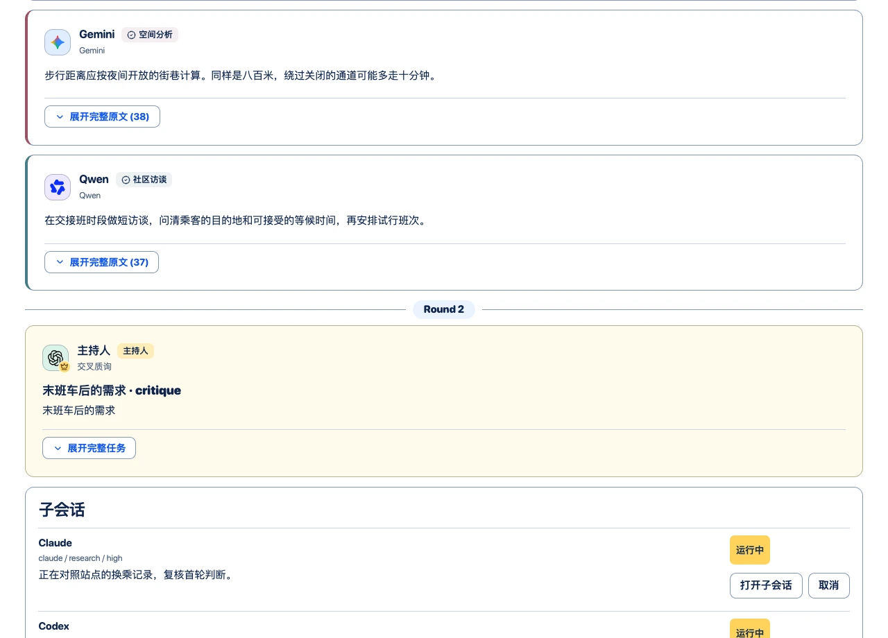
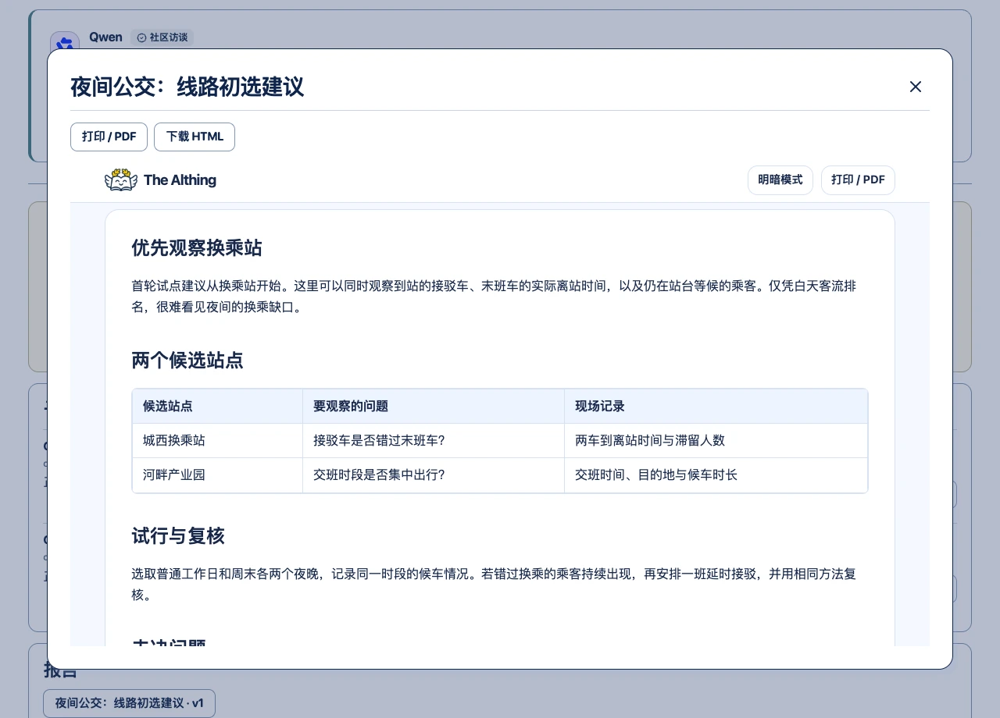

<p align="center"></p>

<h1 align="center">The Althing</h1>

<p align="center"><strong>A council on Olympus, convened in your CodexHost workspace.</strong><br>Give each model a seat and a question to investigate. Let the experts challenge one another, then ask the chair to record what they agree on and what remains open.</p>

<p align="center">⭐ If The Althing is useful to you, please give it a star! ⭐</p>

<p align="center"><a href="https://github.com/mythezone/codexhost-ext-the-althing/releases/latest"></a> <a href="../../LICENSE"></a> <a href="https://github.com/BytePioneer-AI/codexhost-extensions-registry"></a>  </p>

<p align="center">      </p>

<p align="center"><a href="#install">Install</a> · <a href="#quick-start">Quick Start</a> · <a href="#features">Features</a> · <a href="#screenshots">Screenshots</a> · <a href="#development">Development</a> · <a href="https://github.com/mythezone/codexhost-ext-the-althing/releases">Releases</a> · <a href="https://github.com/mythezone/codexhost-ext-the-althing/issues">Issues</a> · <a href="README.zh-CN.md">简体中文</a> · <a href="README.ja.md">日本語</a> · <a href="README.ko.md">한국어</a></p>

<p align="center"></p>

<a id="install"></a>

## Installation

Open **Settings → Plugins** on Desktop or **Plugins → Plugin Center** on Web. Find **The Althing** (`the-althing`) in the marketplace, install it and enable it.

For a manual install, download **`the-althing.zip`** from the latest stable release, import the ZIP in the plugin center and enable it. To follow stable updates from GitHub, select `mythezone/codexhost-ext-the-althing`, choose the asset `the-althing.zip` and leave the tag empty.

[Releases](https://github.com/mythezone/codexhost-ext-the-althing/releases/latest) · [CodexHost Extensions Registry](https://github.com/BytePioneer-AI/codexhost-extensions-registry)

<a id="quick-start"></a>

## Quick Start

```text
/althing Which transit corridor should we pilot after the last bus?
```

1. Enter the command in a Desktop or Web chat and press Enter, or choose **Start a council**. A bare `/althing` opens the same wizard with an empty title.
2. Choose the workspace and number of experts. **Add collaboration experts** uses the ready agents and their defaults from CodexHost. For each seat, choose its agent, model, thinking level and role. The first expert can chair the meeting, or you can select another moderator.
3. Use **Create and plan agenda** to have the chair propose sub-agendas. Review the plan, open a sub-agenda and select **Dispatch round** when you are ready for the experts to speak.
4. Read the opening statements, request a critique, then select **Synthesize**. Publish an agenda report or a final report. In an unarchived council, **Expert roster → Configure roles & agents** changes assignments for subsequent rounds.

<a id="features"></a>

## Features

| Feature | What you can do |
| --- | --- |
| `/althing` | Open the meeting wizard from chat, optionally with a topic already filled in. |
| Multi-agent collaboration & role assignment | See which host agents are ready. Use the host defaults or choose each expert’s and moderator’s model, reasoning level and role. |
| Discussion protocols | Run a standard council, adversarial debate or rapid panel. Dispatch in parallel or in sequence and target a particular contribution for rebuttal. |
| Progress & delegated threads | Follow each seat’s progress, inspect the delegated thread, cancel a running task or retry a failed one. |
| Reports & portable ZIP archives | Read and print reports, download HTML or Markdown, and move the whole council to another host in a ZIP. |
| Desktop, Web & Mobile | Find councils under their Desktop projects or open the Web panel. Narrow screens show conclusion cards and horizontally scrollable tables. |
| Interface languages | English, Simplified Chinese, Traditional Chinese, Japanese and Korean. The default follows CodexHost and falls back to English. Override it under **Interface language** in plugin settings. |

<a id="screenshots"></a>

## Screenshots



Council hub — filter active and archived meetings by project.



Overview — read the chair’s conclusions and unresolved questions.



Discussion — follow each round and expand individual contributions.



Report reader — review a publication, inspect a table or print to PDF.

<a id="roadmap"></a>

## Roadmap

Ideas under consideration, without a release schedule.

- Invite experts running on different hosts into the same council.
- Send an agenda in advance and let participants confirm their seats.
- Review time and model-reported usage by expert and agenda.

<a id="development"></a>

## Development & Architecture

The React workspace runs in Desktop and Web. An ESM backend stores councils locally and delegates work through CodexHost. Develop with Node.js 22.12+ and npm.

```sh
npm ci
npm run typecheck
npm run build
npm run pack
npm run validate:registry
npm test
```

Install Chromium and WebKit once for the touch and narrow-screen regressions.

```sh
npx playwright-core install chromium webkit
npm run test:mobile
```

For local installation, import the built `dist/` directory (the one containing `manifest.json`) in the plugin center and enable it. Release files are written to `dist-release/`.

<a id="backend-contract"></a>

### Backend contract

Every method uses the `althing/` prefix. Resource fields use snake_case, while RPC parameters use names such as `topicId`. The built-in client handles operation receipts and chunk transfers.

| RPC family | Contract |
| --- | --- |
| `capabilities, codexhost/*` | Discover methods and host workspaces. `agents({ cwd?, refresh? })` returns readiness, collaboration defaults and model-specific thinking options. |
| `topics/*` | Create, list, read, update or delete topics. `get({ topicId, summaryOnly: true })` omits long text. `body({ topicId, kind, resourceId })` fetches a contribution or dispatch body. |
| `agendas/*, sub-agendas/*, dispatches/*, contributions/*` | Create agendas, sub-agendas and dispatches. Create contributions or edit their summaries and tags. Previously published full text is immutable. |
| `council/*` | Plan a topic, dispatch a round, synthesize, conclude an agenda or generate a report. List runs and cancel or retry by `runId`. |
| `reports/*` | Publish a report or retrieve it separately with `topicId` and `reportId`. Reports and offline viewers accept a locale for the publication interface. |
| `archives/*, exports/*` | Create and list archives. Import through `import-begin`, `import-chunk`, `import-commit`. Download numbered 512 KiB chunks for ZIP, standalone HTML or Markdown bundles. |
| `operations/get, events/since, transfers/release` | Poll pending receipts by `operationId`. For large JSON results, assemble the base64 chunks as UTF-8 and release the transfer. Replay events from a cursor and refresh if the log was truncated. |

<details>
<summary>RPC examples, orchestration and storage</summary>

Every method starts with `althing/`. `capabilities` returns the registered methods. Resource fields use the Althing protocol’s snake_case names. RPC envelopes use camelCase IDs. For example, a page can create a council with `topics/create` and then schedule an opening round with `council/dispatch-round`.

```js
const topic = await invoke("topics/create", {
  data: {
    title: "Independent replication review",
    metadata: {
      codexhost: {
        project_cwd: project.cwd,
        project_label: project.name,
        panelist_threads: {
          reviewer: { harnessId: "codex", model: selectedModel, thinking: "high" }
        }
      }
    },
    panelists: [{ id: "reviewer", name: "Reviewer", role: "Replication reviewer" }],
    agendas: [{ title: "Evidence", sub_agendas: [{ title: "Replication" }] }]
  }
});
const { dispatch, runs } = await invoke("council/dispatch-round", {
  topicId: topic.id,
  subAgendaId: topic.agendas[0].sub_agendas[0].id,
  round_type: "opening",
  target_panelist_ids: ["reviewer"]
});
```

Here `invoke` denotes the shared RPC client method `rpc.call`, which handles both transport responses below.

- **Slow operation.** A call still running after 1.4 seconds returns `{ operationId, status: "pending" }`. Poll `operations/get` with `{ operationId }` until it returns the original result or throws the operation’s error. Completed receipts are available for five minutes within the current activation. Poll the receipt for a mutation to avoid submitting it twice.
- **Large JSON result.** `{ downloadId, encoding: "json", totalBytes }` identifies a stable UTF-8 JSON file. Call `exports/download-chunk` with `{ downloadId, chunkIndex }` starting at zero. Decode each base64 chunk individually, concatenate the bytes, then decode UTF-8 and parse JSON. Call `transfers/release` with `{ transferId: downloadId }` when finished.

| RPC family | Request and result |
| --- | --- |
| `topics` | `create({ data })`, `get({ topicId, summaryOnly? })`, `body({ topicId, kind, resourceId })`, `update({ topicId, patch })`, `delete({ topicId })`, and `list({ q?, status?, tag?, projectCwd? })`. Lists return cards. Topic trees include report metadata. |
| `agendas`, `sub-agendas`, `dispatches`, `contributions` | Send `topicId` and `data` for creation. Sub-agendas take `agendaId`. Dispatches and contributions take `subAgendaId`. Updates take the resource ID and `patch`. |
| `reports` | `publish({ topicId, data })` returns report metadata. `get({ topicId, reportId })` returns the complete publication. |
| `archives` | Create or list with `topicId`. Download a saved archive with `{ topicId, archiveId, chunkIndex }`. `import-begin({ totalBytes })` allocates an `uploadId`. Send `import-chunk({ uploadId, chunkIndex, base64 })` for each 512 KiB chunk, then `import-commit({ uploadId })`. A repeated commit returns the same restored `topicId`. Release the upload after receiving this result. |
| `exports` | Start `download-chunk({ topicId, format, chunkIndex: 0 })`. Use the returned `downloadId` for subsequent chunks of that snapshot. Supported formats are `archive-zip`, `standalone-html`, and `markdown-bundle`. Release the download after assembly. |
| `events/since` | `{ cursor, topicId? }` returns `{ cursor, events, activeRunCount, truncated }`. Advance using the returned cursor. Refresh cards or the topic tree if older events have expired. |
| `codexhost` | `status`, `projects`, `threads`, `harnesses`, and `harness-inspect` provide Host inventory. Use `agents({ cwd?, refresh? })` for readiness, collaboration defaults and model-specific thinking choices. Inspect with `{ harnessId, cwd?, refresh? }`. Select the project from `projects` and an advertised model from the inspection catalog. |

The reader requests `summaryOnly: true` on entry. Each sub-agenda carries its contribution summaries once. Dispatches reference them by `contribution_ids`. The empty `full_content` and `prompt_full` fields have matching Unicode character counts in `full_content_length` and `prompt_full_length`. Expanding a response or prompt fetches `{ text }` from `topics/body` with kind `contribution` or `dispatch`. Omitting `summaryOnly` returns the complete topic tree.

#### Council runs

- Dispatch accepts `round_number`, `round_type`, `target_panelist_ids`, `target_contribution_ids`, `prompt_full`, `prompt_summary`, and `refs`. Critiques and rebuttals continue the panelist’s existing thread. A sequential sub-agenda admits one slot at a time. Completed panelist slots contribute to progress, with one final slot reserved for synthesis.
- Moderator actions use `topicId`. `synthesize-sub-agenda` also takes `subAgendaId`. `conclude-agenda` takes `agendaId` and optional `publishReport`. `generate-report` accepts an optional `agendaId` and `completeTopic` for a final report. `plan-topic` appends the returned agenda plan after validating its dependencies. Moderator actions accept an optional `prompt` and `moderator_config`.
- `council/runs({ topicId })` returns persisted runs. `cancel-run` and `retry-run` take `{ topicId, runId }`. Cancellation of an active thread is asynchronous. A retry has a new run ID and the same discussion slot.
- The Host reads backend settings on activation. Reactivate after changing the data directory, endpoint, token, or default protocol. Open views subscribe to language, theme and sidebar settings.
- Import creates an archived topic with fresh resource IDs and a first archive snapshot. Historical run links point to the restored resources. An unfinished source turn is recorded as cancelled in the copy, and its original status is retained in `archivedStatus`. Thread handles in the imported roster are historical.

#### Storage and verification

The Host IPC thread and the storage/orchestration worker share one process. The worker has a 128 MiB old-space limit. Storage writes stage private files, commit a redo journal, and recover interrupted transactions on open. Report bodies reside in separate files. The local Host credential file is discovered from the Host data root independently of a custom council directory.

The frontend tests mount the production bundles in Shadow DOM and exercise the Desktop sidebar, the Web panel, and chunked transfers. Backend tests validate protocol schemas, Python v1 archive compatibility, storage recovery and a complete council against an in-process HTTP Host. Packaging tests run the pinned registry validator on valid and invalid release fixtures. The binary fixture in `tests/fixtures/python-v1.zip` came from the repository’s Python archive writer.

</details>

<a id="contributing"></a>

## Contributing

Open an issue with the host version, language and steps to reproduce. For a change, open a focused pull request, add the relevant tests and run the checks above. For translations, update the shared catalog in `src/shared/`, check the language in both the workspace and the composer hint, and include a screenshot of changed controls.

[Issues](https://github.com/mythezone/codexhost-ext-the-althing/issues) · [Pull requests](https://github.com/mythezone/codexhost-ext-the-althing/pulls)

<a id="contributors"></a>

## Contributors

Maintained by [@mythezone](https://github.com/mythezone) · [All contributors](https://github.com/mythezone/codexhost-ext-the-althing/graphs/contributors)

<a id="acknowledgements"></a>

## Acknowledgements

CodexHost provides the workspaces, agent catalog and delegation API. The Extensions Registry distributes the marketplace catalog. [CodexHost](https://github.com/BytePioneer-AI/codex-host) · [CodexHost Extensions Registry](https://github.com/BytePioneer-AI/codexhost-extensions-registry)

Built with [React](https://react.dev), [Marked](https://marked.js.org), [DOMPurify](https://github.com/cure53/DOMPurify), [parse5](https://parse5.js.org), [Zod](https://zod.dev), [Lucide](https://lucide.dev), [esbuild](https://esbuild.github.io).

<a id="license"></a>

## License

Distributed under the MIT License. [MIT](../../LICENSE)
